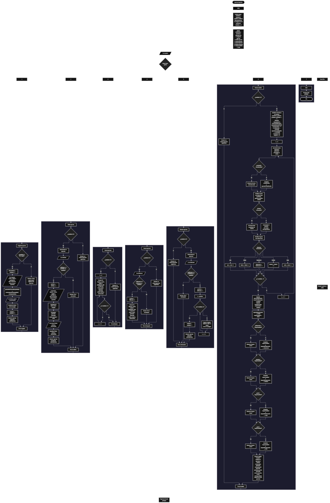

Este proyecto, llamado <b>apuesta deportiva</b>, fue desarrollado en <b>visual basic .net</b> como un ejercicio práctico para fortalecer la lógica de programación mediante la creación de un sistema de gestión de apuestas deportivas desde la consola. El programa cuenta con un menú principal de siete opciones que permite <b>registrar, editar, eliminar, buscar y listar apuestas, además de consultar un análisis estadístico</b> de los registros almacenados. Cada apuesta contiene información como el deporte, el evento, el equipo o participante, el tipo de apuesta, la cuota, el monto apostado, la ganancia potencial, la fecha, el estado y las observaciones, utilizando arreglos con una capacidad máxima de <b>10 apuestas durante la ejecución</b>. Durante su desarrollo se aplicaron conceptos fundamentales de programación, como variables, arreglos, estructuras condicionales, ciclos repetitivos y estructuras de selección, además de operaciones aritméticas, acumuladores, contadores y procesos para buscar, modificar, eliminar y reorganizar registros. Este proyecto permite poner en práctica los conocimientos adquiridos en Visual Basic .NET y sirve como base para desarrollar sistemas de gestión más completos utilizando otros lenguajes y tecnologías.

<h2 align="center">⚙️ Funcionamiento del menú principal</h2>

### ➕ Registrar apuesta

La opción <b>1) registrar apuesta</b> permite almacenar una nueva apuesta deportiva. Antes de realizar el registro, el sistema comprueba que la cantidad de apuestas almacenadas sea menor que la capacidad máxima de los arreglos, utilizando la condición <b>cantidad &gt;= ids.Length</b>. Si existe espacio disponible, genera un identificador mediante la expresión <b>ids(cantidad) = cantidad + 1</b> y solicita los datos correspondientes: <b>deporte, evento, equipo o participante, tipo de apuesta, cuota, monto apostado, fecha, estado y observación</b>. Después, calcula automáticamente la ganancia potencial multiplicando el monto apostado por la cuota mediante la operación <b>gananciasPotenciales(cantidad) = montosApostados(cantidad) * cuotas(cantidad)</b>. Finalmente, incrementa la variable <b>cantidad</b> en uno y muestra el mensaje <b>"Apuesta registrada correctamente."</b>. Si los arreglos alcanzan su capacidad máxima, presenta el mensaje <b>"No hay espacio para registrar mas apuestas."</b>, impidiendo agregar otro registro.

### ✏️ Editar apuesta

La opción <b>2) editar apuesta</b> permite modificar la información de una apuesta registrada. Primero, el programa comprueba si existen apuestas almacenadas mediante la variable <b>cantidad</b>. Si no hay registros, muestra el mensaje <b>"No existen apuestas registradas."</b>. En caso contrario, utiliza un ciclo <b>For...Next</b> para presentar la información completa de todas las apuestas. Después, solicita el identificador de la apuesta que se desea editar y comprueba que se encuentre dentro del rango permitido mediante la condición <b>idEditar &gt;= 1 And idEditar &lt;= cantidad</b>. Si la selección es válida, calcula su posición utilizando <b>posicion = idEditar - 1</b> y solicita los nuevos datos del deporte, evento, equipo o participante, tipo de apuesta, cuota, monto apostado, fecha, estado y observación. También vuelve a calcular la ganancia potencial utilizando el nuevo monto y la nueva cuota. Finalmente, muestra el mensaje <b>"Apuesta actualizada correctamente."</b>. Si el identificador introducido no se encuentra dentro del rango permitido, presenta el mensaje <b>"ID no encontrada."</b>.

### 📋 Listar apuestas

La opción <b>3) listar apuestas</b> permite visualizar todas las apuestas registradas actualmente en el sistema. Antes de mostrar la información, el programa comprueba si la variable <b>cantidad</b> es igual a cero. Si no existen registros, presenta el mensaje <b>"No existen apuestas registradas."</b>. Si hay apuestas disponibles, utiliza un ciclo <b>For...Next</b> para recorrer los arreglos desde la primera posición hasta la última apuesta registrada. Durante el recorrido, muestra el identificador, deporte, evento, equipo o participante, tipo de apuesta, cuota, monto apostado, ganancia potencial, fecha, estado y observación de cada registro. Esta función facilita consultar toda la información almacenada sin necesidad de buscar cada apuesta individualmente.

### 🔎 Buscar apuesta

La opción <b>4) buscar apuesta</b> permite localizar una apuesta mediante su identificador. Primero, el programa comprueba si existen apuestas registradas. Si el sistema está vacío, muestra el mensaje <b>"No existen apuestas registradas."</b>. En caso contrario, solicita el identificador de la apuesta que se desea buscar y verifica que se encuentre dentro del rango permitido mediante la condición <b>idBuscar &gt;= 1 And idBuscar &lt;= cantidad</b>. Si el identificador es válido, calcula la posición correspondiente mediante <b>posicion = idBuscar - 1</b> y muestra toda la información de la apuesta seleccionada, incluyendo sus datos deportivos, cuota, monto apostado, ganancia potencial, fecha, estado y observación. Si el identificador introducido no corresponde al rango de registros disponibles, presenta el mensaje <b>"ID no encontrada."</b>.

### 🗑️ Eliminar apuesta

La opción <b>5) eliminar apuesta</b> permite eliminar una apuesta registrada mediante su identificador. Antes de comenzar, el programa comprueba que existan apuestas almacenadas. Si no hay registros, muestra el mensaje <b>"No existen apuestas registradas."</b>. Si existen apuestas disponibles, presenta una lista con toda su información y solicita el identificador de la apuesta que se desea eliminar. Después, comprueba que el identificador esté dentro del rango válido. Si la selección es correcta, calcula la posición mediante <b>posicion = idEliminar - 1</b> e inicia el proceso de eliminación utilizando un ciclo <b>For...Next</b>. Durante este recorrido, desplaza una posición hacia atrás los datos de las apuestas posteriores en los once arreglos: <b>ids, deportes, eventos, equiposParticipantes, tiposApuesta, cuotas, montosApostados, gananciasPotenciales, fechas, estados y observaciones</b>. Posteriormente, disminuye la variable <b>cantidad</b> en uno y muestra el mensaje <b>"Apuesta eliminada correctamente."</b>. Si el identificador no se encuentra dentro del rango permitido, presenta el mensaje <b>"ID no encontrada."</b>.

### 📊 Mostrar análisis

La opción <b>6) mostrar análisis</b> permite consultar un resumen estadístico y económico de las apuestas registradas. Primero, el programa comprueba si existen apuestas almacenadas. Si no hay registros, muestra el mensaje <b>"No existen apuestas registradas."</b>. En caso contrario, inicializa diferentes contadores para clasificar las apuestas según su estado: <b>pendientes, ganadas, perdidas y anuladas</b>. También inicializa acumuladores para calcular el <b>monto total apostado, la ganancia potencial total y la suma de las cuotas</b>. Mediante un ciclo <b>For...Next</b>, recorre los registros, acumula los valores económicos, calcula la cuota más alta y guarda el nombre del evento correspondiente. Además, utiliza estructuras <b>Select Case</b> para clasificar las apuestas por estado y deporte, contabilizando las categorías <b>fútbol, baloncesto, béisbol, tenis y otros</b>. Después del recorrido, calcula el promedio apostado y la cuota promedio dividiendo sus respectivos acumulados entre la cantidad de apuestas. Finalmente, compara los contadores de los deportes para determinar cuál tiene más apuestas y muestra un resumen con el total de registros, los estados, los valores económicos, los promedios, la cuota más alta, el evento correspondiente y el deporte con mayor cantidad de apuestas.

### 🚪 Salir del menú principal

La opción <b>7) salir</b> está destinada a finalizar la ejecución del programa y muestra el mensaje <b>"Gracias por utilizar Apuesta Deportiva."</b>. El menú principal se encuentra dentro de una estructura repetitiva <b>Do...Loop While</b>, que mantiene el programa en funcionamiento mientras la opción seleccionada sea diferente de <b>7</b>. Cuando el usuario selecciona esta opción, se ejecuta el mensaje de despedida y la condición <b>opcion &lt;&gt; 7</b> deja de cumplirse, finalizando correctamente el ciclo y la ejecución del programa.

<h2 align="center">🧠 Temas aplicados en el proyecto</h2>

### 📦 Variables

En este proyecto se utilizan variables para almacenar la opción seleccionada en el menú, controlar la cantidad de apuestas registradas, seleccionar las posiciones de los arreglos, guardar los identificadores introducidos por el usuario y realizar los cálculos estadísticos y económicos. También se utilizan contadores para clasificar las apuestas según sus estados y deportes, así como acumuladores para sumar los montos apostados, las ganancias potenciales y las cuotas. Cada variable cumple una función específica dentro de las operaciones de gestión y análisis.

🔢 **Opcion:** Almacena la opción seleccionada por el usuario en el menú principal.

📊 **Cantidad:** Controla el número actual de apuestas registradas.

🆔 **Ids:** Almacena los identificadores asignados a las apuestas.

🔄 **I:** Funciona como contador en los ciclos `For...Next` y permite recorrer las posiciones de los arreglos.

📍 **IdEditar:** Almacena el identificador de la apuesta que se desea modificar.

🔎 **IdBuscar:** Almacena el identificador de la apuesta que se desea consultar.

🗑️ **IdEliminar:** Almacena el identificador de la apuesta que se desea eliminar.

📌 **Posicion:** Determina la posición del arreglo correspondiente al identificador seleccionado.

📊 **Pendientes, Ganadas, Perdidas y Anuladas:** Almacenan la cantidad de apuestas clasificadas según su estado.

💰 **MontoTotalApostado:** Acumula todos los montos de dinero registrados en las apuestas.

📈 **GananciaPotencialTotal:** Acumula las ganancias potenciales calculadas para las apuestas.

➗ **SumaCuotas:** Acumula las cuotas de todas las apuestas para calcular su promedio.

⭐ **CuotaMasAlta:** Almacena el valor de la cuota más elevada encontrada.

🏆 **ApuestaCuotaMasAlta:** Guarda el nombre del evento correspondiente a la cuota más alta.

⚽ **Futbol, Baloncesto, Beisbol, Tenis y Otro:** Funcionan como contadores para clasificar las apuestas según el deporte.

📊 **PromedioApostado:** Almacena el promedio del monto apostado por registro.

📉 **CuotaPromedio:** Almacena el promedio de las cuotas registradas.

🏅 **DeporteMasApostado:** Guarda el nombre del deporte que presenta la mayor cantidad de apuestas.

🔢 **MayorCantidad:** Almacena la cantidad más alta de apuestas encontrada al comparar los deportes.

### 🗃️ Arreglos

En este proyecto se utilizan once arreglos paralelos relacionados con la información de cada apuesta deportiva. Cada arreglo tiene una capacidad de <b>10 posiciones</b> y utiliza el mismo índice para representar los datos correspondientes a un mismo registro. Por ejemplo, la información de una apuesta almacenada en la posición <b>0</b> se encuentra distribuida entre <b>ids(0), deportes(0), eventos(0), equiposParticipantes(0), tiposApuesta(0), cuotas(0), montosApostados(0), gananciasPotenciales(0), fechas(0), estados(0) y observaciones(0)</b>. Esta organización permite recorrer, buscar, modificar, mostrar y eliminar las apuestas de manera ordenada.

🆔 **Ids[10]:** Almacena los identificadores de las apuestas registradas.

⚽ **Deportes[10]:** Almacena los deportes correspondientes a cada apuesta.

🏟️ **Eventos[10]:** Guarda los nombres de los eventos deportivos.

👥 **EquiposParticipantes[10]:** Almacena los equipos o participantes involucrados.

🎯 **TiposApuesta[10]:** Guarda los tipos de apuesta registrados.

📈 **Cuotas[10]:** Almacena las cuotas correspondientes a cada apuesta.

💰 **MontosApostados[10]:** Guarda los montos de dinero apostados.

🏆 **GananciasPotenciales[10]:** Almacena los resultados de multiplicar los montos apostados por sus respectivas cuotas.

📅 **Fechas[10]:** Guarda las fechas correspondientes a las apuestas.

📊 **Estados[10]:** Almacena los estados de las apuestas.

📝 **Observaciones[10]:** Guarda información adicional de cada registro.

### 🔀 Estructuras condicionales

En este proyecto se utilizan las estructuras <b>If...Else</b> para comprobar si existe espacio disponible antes de registrar una apuesta, verificar si hay registros antes de ejecutar determinadas operaciones y validar que los identificadores introducidos estén dentro del rango permitido. También se utilizan para comparar las cuotas y determinar cuál es la más alta, así como para calcular cuál es el deporte con mayor cantidad de apuestas. Estas condiciones permiten que el programa responda de manera diferente según la información almacenada y el resultado de cada operación.

### 🔄 Estructuras repetitivas

En este proyecto se utilizan los ciclos <b>Do...Loop While</b> y <b>For...Next</b>. El ciclo <b>Do...Loop While</b> mantiene activo el menú principal y permite ejecutar diferentes operaciones hasta que el usuario selecciona la opción <b>7) salir</b>. Por otro lado, los ciclos <b>For...Next</b> permiten recorrer los arreglos para mostrar las apuestas, seleccionar registros y realizar los cálculos estadísticos. Durante la eliminación también se utilizan para desplazar los datos de las apuestas posteriores una posición hacia atrás, manteniendo organizados los registros activos.

### 🎯 Estructura según

El programa utiliza la estructura <b>Select Case</b> para evaluar el valor almacenado en la variable <b>opcion</b> y ejecutar las instrucciones correspondientes a cada alternativa del menú principal. Cada caso representa una operación específica: <b>registrar, editar, listar, buscar, eliminar, mostrar análisis o salir</b>. También se utiliza el bloque <b>Case Else</b> para mostrar el mensaje <b>"Opcion no valida."</b> cuando el usuario introduce un número que no coincide con ninguna de las opciones definidas. Esta estructura también se aplica en el análisis estadístico para clasificar las apuestas según su estado y deporte.

### 🔢 Dimensionamiento de arreglos

El programa utiliza la declaración de arreglos con un límite de índice igual a <b>9</b>, como en <b>Dim ids(9) As Integer</b>. En Visual Basic .NET, esta declaración permite utilizar las posiciones desde <b>0 hasta 9</b>, proporcionando una capacidad total de <b>10 apuestas</b> por arreglo. Los once arreglos mantienen la misma capacidad y la variable <b>cantidad</b> controla cuántos registros se encuentran ocupados. Antes de registrar una nueva apuesta, el programa comprueba la capacidad disponible mediante la propiedad <b>Length</b> del arreglo <b>ids</b>.

### 🔄 Reorganización de registros

Cuando se selecciona una apuesta para eliminarla, el programa utiliza un ciclo <b>For...Next</b> que comienza en la posición seleccionada y llega hasta <b>cantidad - 2</b>. En cada repetición, los datos de la posición siguiente se copian sobre la posición actual en los once arreglos: <b>ids, deportes, eventos, equiposParticipantes, tiposApuesta, cuotas, montosApostados, gananciasPotenciales, fechas, estados y observaciones</b>. Después, la variable <b>cantidad</b> disminuye en uno, reduciendo el número de registros activos. De esta manera, los datos posteriores ocupan las posiciones disponibles sin dejar espacios vacíos entre las apuestas registradas. Sin embargo, los identificadores no se renumeran después de la eliminación.

### 🧮 Operaciones aritméticas y estadísticas

El proyecto incorpora operaciones aritméticas para calcular los resultados económicos y estadísticos de las apuestas. Durante el registro y la edición, multiplica el monto apostado por la cuota para obtener la ganancia potencial. En el análisis, utiliza sumas para acumular los montos, las ganancias potenciales y las cuotas, y divisiones para calcular el promedio apostado y la cuota promedio. También utiliza comparaciones para identificar la cuota más alta y el deporte con mayor cantidad de apuestas registradas. Estos procesos permiten obtener información resumida a partir de los datos almacenados.

<h2 align="center">¿Cómo se implementaron las operaciones crud en el proyecto?</h2>

Las operaciones <b>crud</b> se implementaron mediante las opciones del menú principal, permitiendo administrar las apuestas deportivas registradas. La operación <b>crear</b> corresponde a <b>registrar apuesta</b>, donde se introducen los datos de un nuevo registro y se calcula su ganancia potencial; <b>leer</b> se realiza mediante las opciones <b>buscar apuesta, listar apuestas y mostrar análisis</b>, que permiten consultar los datos individuales, visualizar todos los registros y obtener estadísticas generales; <b>actualizar</b> corresponde a <b>editar apuesta</b>, donde se modifican los datos de una apuesta existente y se actualiza su ganancia potencial; y <b>eliminar</b> se realiza mediante la opción <b>eliminar apuesta</b>, que desplaza los registros posteriores para reorganizar los arreglos. Estas operaciones utilizan variables, arreglos, condicionales y ciclos para gestionar la información almacenada temporalmente durante la ejecución del programa.

<h2 align="center">Diagrama de flujo del proyecto</h2>

<h2 align="center">🛡️ Validaciones del programa</h2>

### 📭 No existen apuestas registradas

Esta validación se utiliza en las opciones de <b>editar, listar, buscar, eliminar y mostrar análisis</b>. El programa comprueba si la variable <b>cantidad</b> es igual a <b>0</b> y, si no existen apuestas registradas, muestra el mensaje <b>"No existen apuestas registradas."</b>. Esta comprobación evita continuar con las operaciones que necesitan información almacenada cuando el sistema está vacío.

### ⚠️ Capacidad máxima alcanzada

Esta validación se utiliza durante el registro de nuevas apuestas para controlar la capacidad máxima de los arreglos. El programa comprueba si <b>cantidad &gt;= ids.Length</b> antes de permitir agregar un nuevo registro. Si existe espacio disponible, genera el identificador, solicita los datos y aumenta el contador. En caso contrario, muestra el mensaje <b>"No hay espacio para registrar mas apuestas."</b>, impidiendo agregar más registros cuando se alcanza la capacidad de diez apuestas.

### 🔢 Identificador de apuesta no encontrado

Esta validación se utiliza durante las operaciones de <b>editar, buscar y eliminar</b>. El programa comprueba que el identificador introducido sea mayor o igual a <b>1</b> y menor o igual a <b>cantidad</b>. Si el valor se encuentra dentro del rango permitido, calcula la posición correspondiente restándole uno al identificador. Si el valor no cumple estas condiciones, muestra el mensaje <b>"ID no encontrada."</b>, evitando acceder directamente a una posición fuera del rango de registros activos.

### 💰 Cálculo de la ganancia potencial

El programa calcula automáticamente la ganancia potencial de cada apuesta mediante la multiplicación del <b>monto apostado</b> por la <b>cuota</b>. Esta operación se ejecuta durante el registro y también cuando se editan los datos de una apuesta. De esta manera, el valor almacenado en <b>gananciasPotenciales</b> se actualiza de acuerdo con el monto y la cuota introducidos. Este cálculo representa el retorno potencial total según la fórmula utilizada, no una ganancia neta después de descontar el monto apostado.

### 📊 Clasificación de estados

Durante el análisis, el programa utiliza <b>Select Case estados(i).ToLower()</b> para clasificar las apuestas según su estado. Reconoce las categorías <b>"pendiente", "ganada", "perdida" y "anulada"</b>, aumentando el contador correspondiente cuando encuentra una coincidencia. El uso de <b>ToLower()</b> permite reconocer los estados sin distinguir entre mayúsculas y minúsculas. Los valores diferentes de estas categorías no se contabilizan en los cuatro contadores.

### ⚽ Clasificación de deportes

El programa utiliza <b>Select Case deportes(i).ToLower()</b> para clasificar las apuestas según el deporte registrado. Reconoce las categorías <b>"futbol" o "fútbol", "baloncesto", "beisbol" o "béisbol", y "tenis" o "tennis"</b>. Cuando el deporte no coincide con ninguna de estas categorías, se contabiliza automáticamente dentro del grupo <b>"Otro"</b> mediante el bloque <b>Case Else</b>. Posteriormente, compara los contadores para determinar cuál es el deporte con mayor cantidad de apuestas.

### 🏆 Cuota más alta

El programa inicializa la variable <b>cuotaMasAlta</b> con la cuota de la primera apuesta y guarda su evento en <b>apuestaCuotaMasAlta</b>. Después, recorre los registros y compara cada cuota mediante la condición <b>cuotas(i) &gt; cuotaMasAlta</b>. Cuando encuentra una cuota superior, actualiza tanto el valor máximo como el nombre del evento correspondiente. Al finalizar el recorrido, muestra la cuota más alta y el evento asociado.

### 📈 Cálculo de promedios

Durante el análisis, el programa calcula el promedio del monto apostado y el promedio de las cuotas utilizando los acumuladores <b>montoTotalApostado</b> y <b>sumaCuotas</b>. Después de recorrer los registros, divide cada acumulador entre la cantidad total de apuestas mediante las operaciones <b>promedioApostado = montoTotalApostado / cantidad</b> y <b>cuotaPromedio = sumaCuotas / cantidad</b>. Estas operaciones permiten conocer los valores promedio de las apuestas registradas.

### ⚠️ Opción no válida

La estructura <b>Select Case</b> incluye el bloque <b>Case Else</b>, que muestra el mensaje <b>"Opcion no valida."</b> cuando el usuario introduce un número que no corresponde a ninguna de las siete opciones definidas en el menú. Esta condición permite informar al usuario cuando selecciona una alternativa incorrecta y mantener el programa en funcionamiento para realizar otra operación.

### ⚠️ Consideraciones sobre los identificadores y los datos introducidos

El programa utiliza la relación <b>posicion = identificador - 1</b> para seleccionar las apuestas durante las operaciones de edición, búsqueda y eliminación. Esta lógica funciona mientras los identificadores coincidan con las posiciones de los arreglos. Sin embargo, después de eliminar una apuesta, los registros se desplazan, pero sus identificadores no se renumeran. Además, al registrar una nueva apuesta, el identificador se genera utilizando <b>cantidad + 1</b>, lo que puede producir identificadores duplicados. Por otra parte, el programa utiliza <b>Convert.ToInt32</b> y <b>Convert.ToDouble</b> para convertir los datos introducidos, pero no incluye controles para evitar errores cuando el usuario escribe valores no numéricos, cuotas negativas, montos negativos o campos vacíos. Estas son limitaciones del código actual que pueden considerarse en futuras mejoras.

<h2 align="center">🎯 Objetivo del proyecto</h2>

El objetivo principal de este proyecto es fortalecer la <b>lógica de programación</b> mediante el desarrollo de un sistema de gestión y análisis de apuestas deportivas en <b>visual basic .net</b>. A través de su construcción se busca aplicar los conocimientos adquiridos sobre variables, arreglos, estructuras condicionales, ciclos repetitivos y estructuras de selección, integrándolos para resolver un problema de manera organizada. Además, el proyecto permite comprender cómo registrar, consultar, modificar y eliminar información, realizar cálculos aritméticos y generar estadísticas a partir de los datos almacenados en una aplicación de consola, estableciendo una base para desarrollar sistemas de gestión más completos con otros lenguajes y tecnologías.

